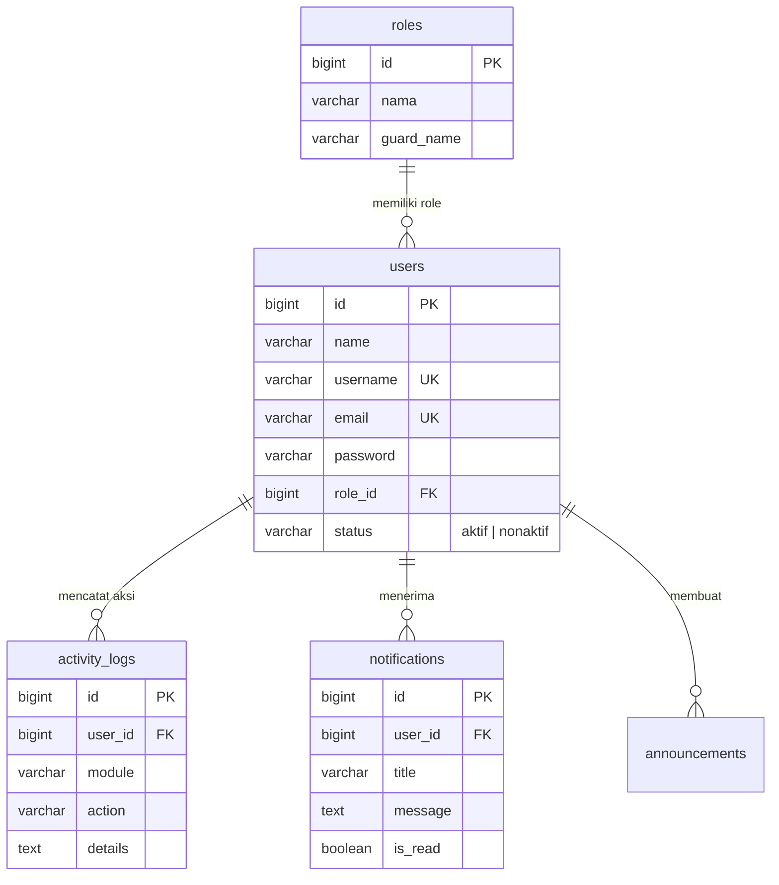
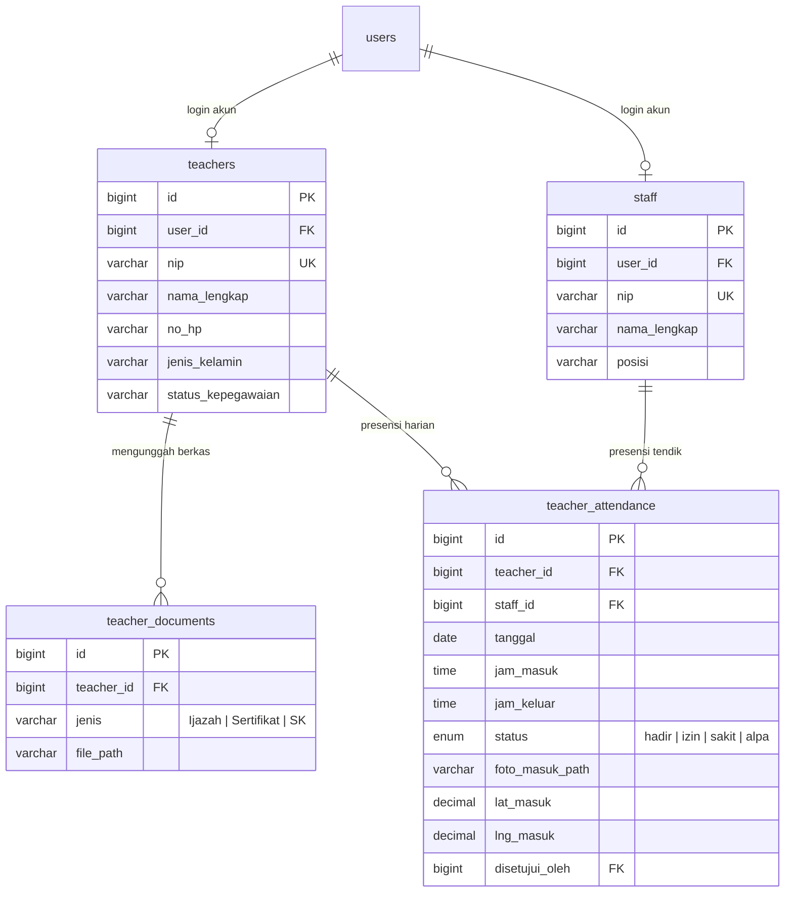
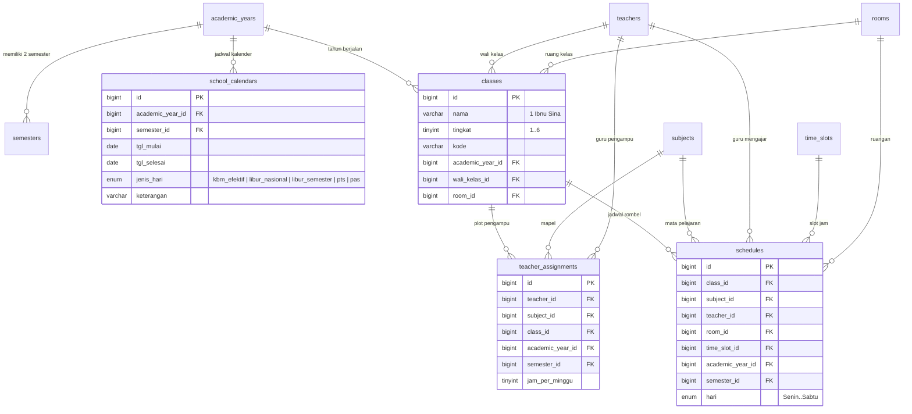
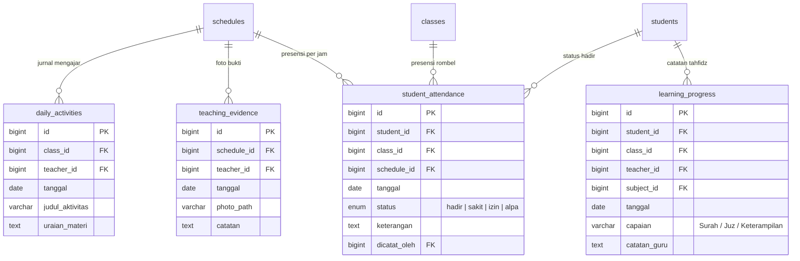
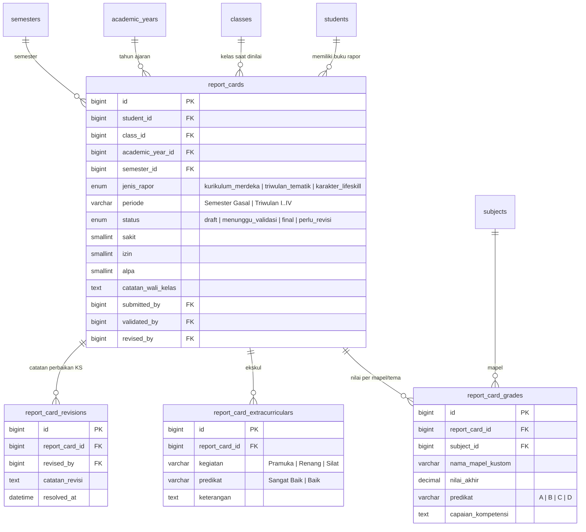
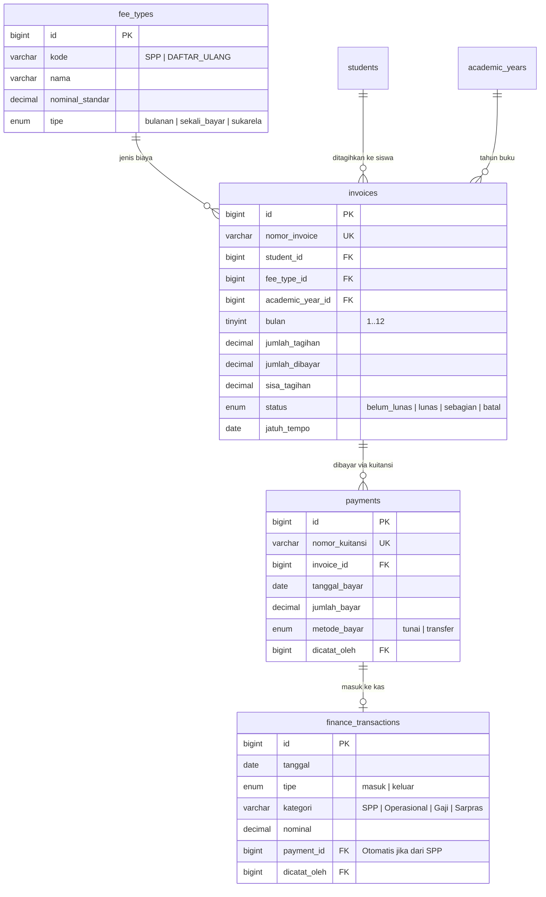
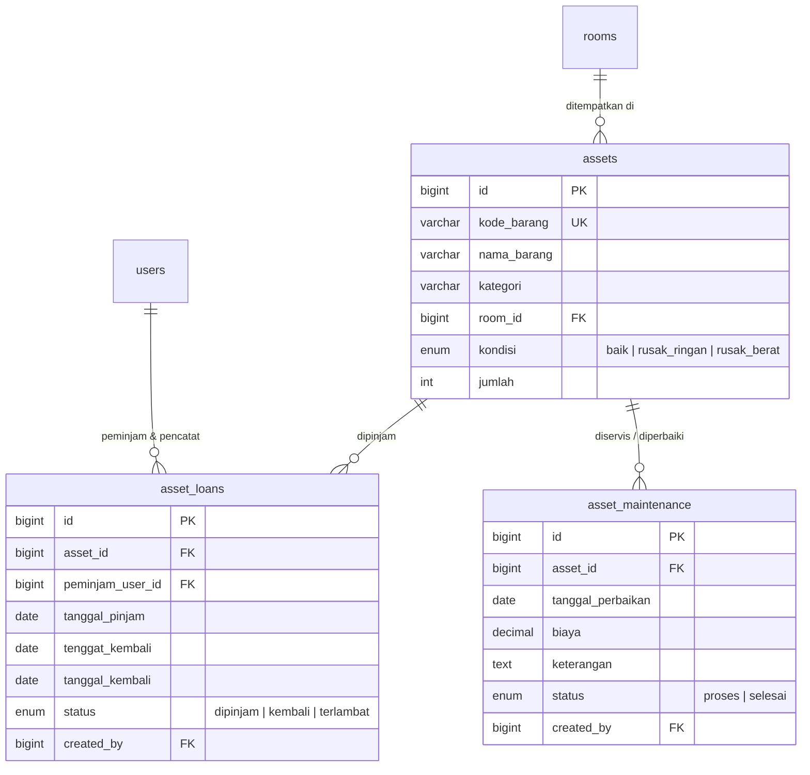

# 🗄️ Dokumentasi Arsitektur Database & Relasi Antar-Tabel SIM-BIM
> **SDI Bina Insan Mandiri (SIM-BIM Purwokerto)**  
> *Panduan Lengkap Skema Database, Klaster Modul, Diagram Relasi (ERD), dan Petunjuk phpMyAdmin Designer*
> 
> 📄 **File Kode PlantUML Lengkap**: Tersedia di [`docs/DATABASE_ERD.puml`](file:///c:/laragon/www/simbim/docs/DATABASE_ERD.puml) (dapat dibuka langsung dengan ekstensi PlantUML di VS Code / IntelliJ atau online renderer).

---

## 📌 1. Mengapa di phpMyAdmin Database Designer Terlihat Menumpuk?

Saat membuka menu **Designer** di phpMyAdmin, seluruh **58 tabel** database `simbim` dimuat sekaligus ke dalam satu kanvas tanpa pengelompokan otomatis. Karena ada **98 relasi foreign key**, garis relasi saling bersilangan (*spiderweb effect*) dan kotak-kotak tabel saling bertumpukan di koordinat yang sama.

Sebenarnya, arsitektur database SIM-BIM **sangat terstruktur, modular, dan mengikuti prinsip Domain-Driven Design (DDD)**. Database ini terbagi menjadi **8 Klaster Fungsional Utama** yang berporos pada beberapa entitas inti (*Core Hub*).

---

## 🏛️ 2. Peta Arsitektur Inti (High-Level Core Hub)

Seluruh sistem berputar di sekitar 5 entitas poros:

```mermaid
flowchart TD
    %% Entitas Poros Utama
    U["👤 users<br/>(Akun Login & Hak Akses)"]
    AY["📅 academic_years & semesters<br/>(Tahun Ajaran & Periode Aktif)"]
    C["🏫 classes<br/>(Rombongan Belajar)"]
    S["🎓 students<br/>(Data Induk Siswa)"]
    T["👨‍🏫 teachers<br/>(Data Guru & Pendidik)"]

    %% Hubungan Inti
    U -.->|Role / Profil| T
    U -.->|Role / Akun| G["👨‍👩‍👧 guardians (Wali)"]
    G <-->|student_guardian (M:N)| S

    AY -->|Memayungi| C
    T -->|Wali Kelas (1:N)| C
    C -->|student_enrollments (M:N)| S

    %% Modul Turunan
    C --> KBM["📚 schedules & assignments<br/>(Jadwal & Penugasan Mengajar)"]
    T --> KBM
    
    KBM --> ABS["⏱️ student_attendance & daily_activities<br/>(Presensi & Aktivitas Belajar)"]
    S --> ABS

    C --> RAP["📑 report_cards<br/>(Rapor Siswa Multi-Format)"]
    S --> RAP
    AY --> RAP

    S --> FIN["💰 invoices & payments<br/>(SPP & Transaksi Keuangan)"]
    AY --> FIN

    classDef hub fill:#047857,stroke:#065f46,stroke-width:2px,color:#fff;
    classDef sub fill:#f8fafc,stroke:#94a3b8,stroke-width:1px,color:#1e293b;
    class U,AY,C,S,T hub;
    class G,KBM,ABS,RAP,FIN sub;
```

---

## 🧩 3. Klasterisasi 8 Modul Fungsional Database

| No | Nama Klaster | Jumlah Tabel | Tabel-Tabel Utama | Penjelasan Singkat |
|:---|:---|:---:|:---|:---|
| **1** | **Autentikasi & Akun** | 6 | `users`, `roles`, `activity_logs`, `notifications`, `settings`, `school_profile` | Manajemen pengguna, role RBAC, audit log, notifikasi sistem, profil sekolah |
| **2** | **Kesiswaan & Orang Tua** | 5 | `students`, `guardians`, `student_guardian`, `student_enrollments`, `student_status_history` | Biodata siswa, relasi wali murid, riwayat mutasi rombel per tahun ajaran |
| **3** | **Kepegawaian (Guru & Staf)** | 4 | `teachers`, `staff`, `teacher_documents`, `teacher_attendance` | Biodata guru/tendik, berkas ijazah/sertifikasi, presensi selfie GPS & approval |
| **4** | **Akademik & Jadwal KBM** | 9 | `academic_years`, `semesters`, `school_calendars`, `rooms`, `classes`, `subjects`, `time_slots`, `teacher_assignments`, `schedules` | Kalender libur/efektif, mapel, plotting guru pengampu, jadwal pelajaran per jam |
| **5** | **KBM Harian & Presensi Siswa** | 4 | `daily_activities`, `teaching_evidence`, `student_attendance`, `learning_progress` | Agenda mengajar harian, foto bukti mengajar, presensi siswa (H/S/I/A), catatan progres tahfidz |
| **6** | **Rapor Multi-Format** | 5 | `report_cards`, `report_card_grades`, `report_card_learning_objectives`, `report_card_extracurriculars`, `report_card_revisions` | Rapor Merdeka, Tematik BIM (5 tema), Karakter/Life Skill, persetujuan KS & revisi |
| **7** | **Keuangan & SPP** | 4 | `fee_types`, `invoices`, `payments`, `finance_transactions` | Pos tarif SPP/daftar ulang, tagihan siswa, kuitansi bayar, buku kas umum sekolah |
| **8** | **Sarana Prasarana (Sarpras)** | 3 | `assets`, `asset_loans`, `asset_maintenance` | Inventaris barang, pencatatan peminjaman aset, riwayat perbaikan/servis |
| **9** | **Tabel Referensi & Teknis** | 18 | `ref_*` (5), `import_*` (2), `backups` (1), Cache & Jobs Laravel (10) | Master agama/pekerjaan, batch import Excel, antrean queue & session |

---

## 🔍 4. Diagram Relasi Detail per Klaster (ERD)

### 📌 Klaster 1: Autentikasi, Pengguna & RBAC
Menghubungkan akun login dengan hak akses (*role*), jejak aktivitas (*activity log*), dan pengumuman.



---

### 📌 Klaster 2: Kesiswaan & Wali Murid
Siswa (`students`) dan Wali Murid (`guardians`) memiliki relasi **Many-to-Many** melalui tabel perantara `student_guardian` (karena satu wali bisa memiliki beberapa anak di sekolah, dan satu anak bisa memiliki ayah, ibu, atau wali). Riwayat kelas per tahun ajaran dicatat di `student_enrollments`.

```mermaid
erDiagram
    students ||--o{ student_guardian : "terhubung"
    guardians ||--o{ student_guardian : "memiliki anak"
    students ||--o{ student_enrollments : "riwayat kelas"
    classes ||--o{ student_enrollments : "berisi siswa"
    academic_years ||--o{ student_enrollments : "pada tahun"
    students ||--o{ student_status_history : "riwayat mutasi"
    classes ||--o{ students : "kelas aktif saat ini"

    students {
        bigint id PK
        varchar nis UK
        varchar nisn UK
        varchar nama_lengkap
        enum jenis_kelamin
        date tgl_lahir
        bigint class_id FK "Rombel saat ini"
        varchar status "aktif | lulus | mutasi | keluar"
    }
    guardians {
        bigint id PK
        bigint user_id FK "Akun portal ortu"
        varchar nama_lengkap
        varchar no_hp
        varchar nik
    }
    student_guardian {
        bigint id PK
        bigint student_id FK
        bigint guardian_id FK
        varchar hubungan "Ayah | Ibu | Wali"
        boolean is_kontak_utama
    }
    student_enrollments {
        bigint id PK
        bigint student_id FK
        bigint class_id FK
        bigint academic_year_id FK
        date tgl_masuk_kelas
        varchar status_kelas "aktif | naik | tinggal"
    }
    student_status_history {
        bigint id PK
        bigint student_id FK
        varchar jenis "mutasi_keluar | lulus | dsb"
        date tanggal
        text alasan
        bigint dicatat_oleh FK
    }
```



---

### 📌 Klaster 3: Kepegawaian (Guru, Staf & Presensi Guru)
Guru dan Staf masing-masing dapat ditautkan ke akun login di tabel `users`. Guru memiliki dokumen portofolio dan riwayat presensi harian (GPS + Selfie).



---

### 📌 Klaster 4: Akademik, Kelas, Kalender & Jadwal KBM
Inilah jantung manajemen akademik. `academic_years` memiliki `semesters`. Kelas memiliki `wali_kelas_id`. Pengampu mata pelajaran diplot via `teacher_assignments`, dan jadwal jam pelajaran disusun di `schedules`.



---

### 📌 Klaster 5: KBM Harian, Presensi Siswa & Progres
Setiap sesi mengajar menghasilkan agenda di `daily_activities`, bukti foto di `teaching_evidence`, presensi per siswa di `student_attendance`, dan rekaman tahfidz di `learning_progress`.



---

### 📌 Klaster 6: Penilaian & Rapor Siswa Multi-Format
Mendukung 3 format rapor sekaligus:
1. **Kurikulum Merdeka**: Nilai akhir per 18 mapel + Capaian Kompetensi + Kokurikuler P5.
2. **Triwulan Tematik BIM**: 5 tema terpadu (Abrisam 1).
3. **Karakter & Life Skill**: 17 butir penilaian (Abrisam 2).

Dilengkapi alur validasi resmi: **Wali Kelas** membuat & mengajukan draf (`submitted_by`), **Kepala Sekolah** memvalidasi (`validated_by`) atau meminta revisi (`report_card_revisions`).



---

### 📌 Klaster 7: Keuangan, Tagihan & Pembayaran (SPP)
Menangani penagihan otomatis SPP bulanan/kegiatan tahunan, kuitansi pembayaran siswa, dan pencatatan kas masuk/keluar ke Buku Kas Umum.



---

### 📌 Klaster 8: Sarana Prasarana (Aset & Inventaris)
Melacak barang inventaris milik sekolah, penempatannya di ruangan tertentu, peminjaman oleh guru/staf, dan perbaikan barang rusak.



---

## 🛠️ 5. Tips & Cara Menata phpMyAdmin Designer agar Tidak Menumpuk

Agar phpMyAdmin Designer tidak menampilkan 58 tabel sekaligus yang bertumpukan, Anda dapat menggunakan fitur **"Pages" (Halaman Kerja Desainer)** bawaan phpMyAdmin:

### Langkah-langkah:
1. Buka phpMyAdmin di browser: `http://localhost/phpmyadmin`
2. Klik database **`simbim`** di sidebar kiri.
3. Klik tab menu **Designer** (di pojok kanan atas).
4. Di panel menu kiri layar desainer, klik ikon **"New page" / "Simpan halaman baru"** (ikon halaman bertanda plus).
5. Beri nama halaman sesuai modul yang ingin Anda tinjau satu per satu, misalnya:
   - `01_Kesiswaan_Wali` (cukup centang: `students`, `guardians`, `student_guardian`, `student_enrollments`, `classes`)
   - `02_Akademik_Jadwal` (cukup centang: `classes`, `subjects`, `teachers`, `rooms`, `time_slots`, `teacher_assignments`, `schedules`)
   - `03_Rapor_Siswa` (cukup centang: `report_cards`, `report_card_grades`, `report_card_extracurriculars`, `report_card_revisions`, `students`, `classes`)
   - `04_Keuangan_SPP` (cukup centang: `fee_types`, `invoices`, `payments`, `finance_transactions`, `students`)
   - `05_Presensi_KBM` (cukup centang: `schedules`, `daily_activities`, `teaching_evidence`, `student_attendance`, `learning_progress`)
6. Setelah tabel-tabel spesifik tersebut muncul di layar, klik tombol **Auto layout** (atau geser kotak tabel sesuai keinginan), lalu klik **Save page**.
7. Anda sekarang memiliki visualisasi yang bersih, lega, dan bebas tumpukan kapan pun ingin melihat skema database!

---

## 📋 6. Ringkasan Matriks Foreign Key (98 Foreign Keys)

Untuk referensi cepat pengembang, berikut adalah pemetaan lengkap tabel induk (*Parent Table*) ke tabel anak (*Child Table*):

| Tabel Induk (Parent) | Kolom Induk | Tabel Anak (Child) | Kolom Foreign Key (FK) | Hubungan Bisnis |
|:---|:---|:---|:---|:---|
| `users` | `id` | `activity_logs` | `user_id` | Pengguna yang melakukan aksi sistem |
| `users` | `id` | `teachers` | `user_id` | Akun login guru |
| `users` | `id` | `staff` | `user_id` | Akun login staf |
| `users` | `id` | `guardians` | `user_id` | Akun login wali murid (Portal Ortu) |
| `users` | `id` | `report_cards` | `submitted_by`, `validated_by` | Wali Kelas pengaju & KS validator rapor |
| `users` | `id` | `payments` | `dicatat_oleh` | Kasir/admin penerima setoran SPP |
| `roles` | `id` | `users` | `role_id` | Role RBAC pengguna |
| `academic_years` | `id` | `semesters` | `academic_year_id` | Semester Gasal/Genap dalam tahun ajaran |
| `academic_years` | `id` | `classes` | `academic_year_id` | Rombel pada tahun ajaran aktif |
| `academic_years` | `id` | `schedules` | `academic_year_id` | Jadwal KBM pada tahun ajaran |
| `academic_years` | `id` | `invoices` | `academic_year_id` | Tagihan SPP pada tahun buku |
| `teachers` | `id` | `classes` | `wali_kelas_id` | Guru yang menjadi Wali Kelas rombel |
| `classes` | `id` | `students` | `class_id` | Kelas aktif siswa saat ini |
| `classes` | `id` | `student_enrollments` | `class_id` | Anggota siswa dalam rombel |
| `classes` | `id` | `schedules` | `class_id` | Jadwal mata pelajaran kelas |
| `students` | `id` | `student_guardian` | `student_id` | Relasi anak ke orang tua/wali |
| `guardians` | `id` | `student_guardian` | `guardian_id` | Relasi orang tua/wali ke anak |
| `students` | `id` | `invoices` | `student_id` | Tagihan diterbitkan untuk siswa |
| `invoices` | `id` | `payments` | `invoice_id` | Pembayaran pelunasan tagihan |
| `payments` | `id` | `finance_transactions` | `payment_id` | Transaksi kas masuk dari pembayaran SPP |
| `students` | `id` | `report_cards` | `student_id` | Buku rapor milik siswa |
| `report_cards` | `id` | `report_card_grades` | `report_card_id` | Baris nilai mata pelajaran/tema rapor |
| `report_cards` | `id` | `report_card_revisions` | `report_card_id` | Catatan revisi dari Kepala Sekolah |
| `schedules` | `id` | `student_attendance` | `schedule_id` | Presensi siswa pada sesi jadwal |
| `schedules` | `id` | `daily_activities` | `schedule_id` | Jurnal materi yang diajarkan pada jadwal |
| `rooms` | `id` | `classes` | `room_id` | Ruang fisik kelas |
| `rooms` | `id` | `assets` | `room_id` | Lokasi penempatan barang inventaris |
| `assets` | `id` | `asset_loans` | `asset_id` | Peminjaman barang aset sekolah |

---
*Dokumentasi ini dibuat otomatis dan terverifikasi langsung dengan skema database riil SIM-BIM (58 tabel & 98 relasi foreign keys).*
