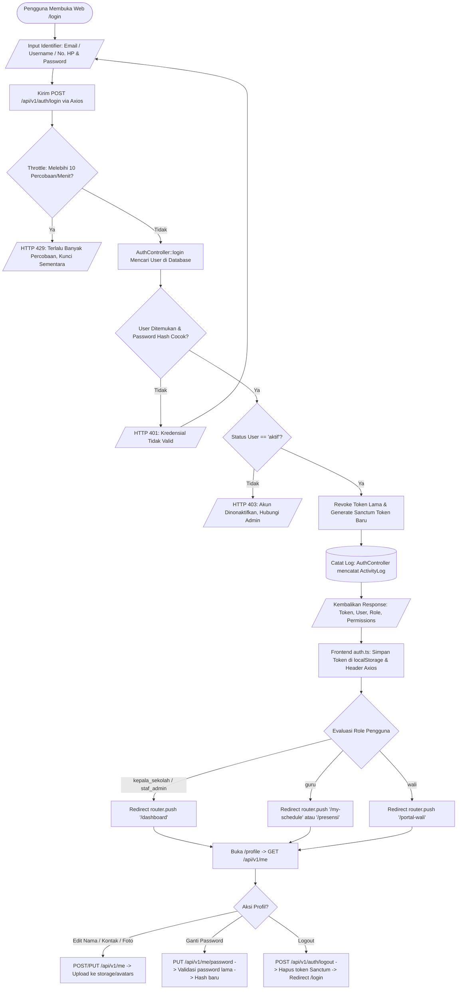
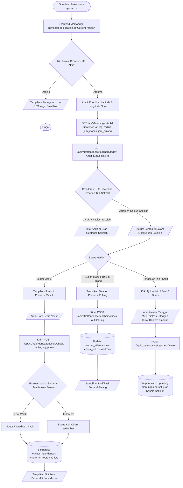
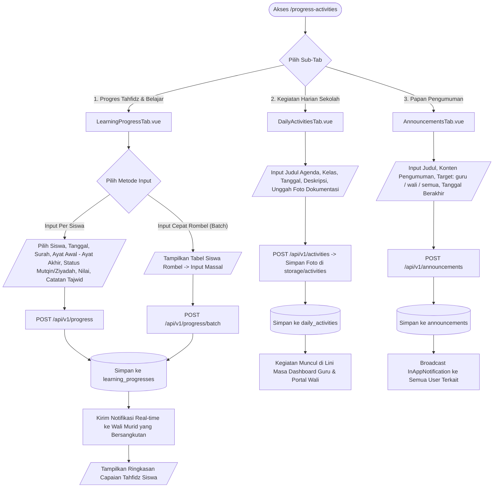

# DOKUMENTASI FLOWCHART SISTEM SIM-BIM
### Berdasarkan Arsitektur Kode Aktual (Backend Laravel & Frontend Vue 3)
**SDI Bina Insan Mandiri Purwokerto**

Dokumen ini disusun berdasarkan **implementasi kode nyata (*actual codebase*)** pada backend (`backend/app/Http/Controllers/Api/`, `routes/api.php`, model Eloquent, dan migrasi database) serta frontend (`frontend/src/views/`, `components/`, dan `router/index.ts`).

---

## Daftar Modul Sesuai Kode Aktual
1. [Modul 1: Autentikasi, Profil & Otorisasi RBAC](#modul-1-autentikasi-profil--otorisasi-rbac)
2. [Modul 2: Master Data Siswa & Manajemen Status Mutasi](#modul-2-master-data-siswa--manajemen-status-mutasi)
3. [Modul 3: Master Data Guru, Tendik & Dokumen Kepegawaian](#modul-3-master-data-guru-tendik--dokumen-kepegawaian)
4. [Modul 4: Master Data & Akun Portal Wali Murid](#modul-4-master-data--akun-portal-wali-murid)
5. [Modul 5: Kelas, Jadwal KBM & Periode Akademik (7 Sub-Tab)](#modul-5-kelas-jadwal-kbm--periode-akademik-7-sub-tab)
6. [Modul 6: Presensi Mandiri Guru (Geofence GPS & Jam Kerja)](#modul-6-presensi-mandiri-guru-geofence-gps--jam-kerja)
7. [Modul 7: KBM Mengajar, Presensi Sesi Siswa & Bukti Foto KBM](#modul-7-kbm-mengajar-presensi-sesi-siswa--bukti-foto-kbm)
8. [Modul 8: Presensi Harian Siswa (Wali Kelas) & Monitoring Homeroom](#modul-8-presensi-harian-siswa-wali-kelas--monitoring-homeroom)
9. [Modul 9: Rekapitulasi Presensi, Koreksi Admin & Verifikasi Izin](#modul-9-rekapitulasi-presensi-koreksi-admin--verifikasi-izin)
10. [Modul 10: Engine Import Excel Master & Sistem Rollback Batch](#modul-10-engine-import-excel-master--sistem-rollback-batch)
11. [Modul 11: Progres Pembelajaran, Mutaba'ah Tahfidz & Agenda Sekolah](#modul-11-progres-pembelajaran-mutabaah-tahfidz--agenda-sekolah)
12. [Modul 12: Penilaian & Cetak Rapor Multi-Format (Merdeka, Tematik, Karakter)](#modul-12-penilaian--cetak-rapor-multi-format-merdeka-tematik-karakter)
13. [Modul 13: Keuangan, Generator Tagihan Massal SPP & Kasir Pembayaran](#modul-13-keuangan-generator-tagihan-massal-spp--kasir-pembayaran)
14. [Modul 14: Inventaris Sarana Prasarana, Servis Aset & Peminjaman](#modul-14-inventaris-sarana-prasarana-servis-aset--peminjaman)
15. [Modul 15: Portal Wali Murid (Parent Portal Mobile View)](#modul-15-portal-wali-murid-parent-portal-mobile-view)
16. [Modul 16: Pengaturan Sistem, Log Audit Aktivitas & Backup/Restore](#modul-16-pengaturan-sistem-log-audit-aktivitas--backuprestore)

---

## Modul 1: Autentikasi, Profil & Otorisasi RBAC
**Backend**: `AuthController.php`, Middleware `auth:sanctum`, Middleware `role:kepala_sekolah,staf_admin,guru,wali`  
**Frontend**: `LoginView.vue`, `ProfileView.vue`, `stores/auth.ts`, `router/index.ts`



---

## Modul 2: Master Data Siswa & Manajemen Status Mutasi
**Backend**: `StudentController.php`, Model `Student`, Model `StudentGuardian`  
**Frontend**: `StudentsView.vue`, `StudentList.vue`, `StudentForm.vue`, `StudentDetail.vue`

```mermaid
flowchart TD
    A([Akses Menu /students]) --> B[GET /api/v1/students dengan Query: search, class_id, status, page]
    B --> C[StudentController::index memuat relasi class, guardians]
    C --> D[/Tampilkan Tabel Siswa, Filter Rombel, & Badge Status/]
    
    D --> E{Pilih Aksi Siswa}
    
    %% Tambah / Edit Siswa
    E -- Tambah / Ubah Siswa --> F[Buka StudentForm.vue Modal / Form]
    F --> G[/Input NIS, NISN, NIK, Nama, Gender, TTL, Alamat, Rombel, Kontak/]
    G --> H[Kirim POST /students atau PUT /students/{id}]
    H --> I{Validasi Unique NIS & NISN di Tabel students}
    I -- Gagal --> J[/Tampilkan Error Validasi Form/] --> F
    I -- Lolos --> K[(StudentController::store/update Simpan Data)]
    K --> L[Hubungkan Relasi Wali via POST /students/{id}/guardians]
    L --> M[Catat ActivityLog: create/update student]
    M --> N[/Tampilkan Swal Sukses & Refresh Tabel/]
    
    %% Detail Siswa
    E -- Lihat Detail Siswa --> O[GET /api/v1/students/{id}]
    O --> P[Buka StudentDetail.vue: Tab Identitas, Wali, Riwayat Absensi, Rapor]
    
    %% Mutasi Status
    E -- Perbarui Status Siswa --> Q[Pilih Status: aktif / lulus / mutasi / keluar]
    Q --> R[Kirim POST /api/v1/students/{id}/status]
    R --> S[(StudentController::updateStatus memperbarui field status)]
    S --> N
    
    %% Export Excel
    E -- Export Excel Siswa --> T[Klik Tombol: Export Excel]
    T --> U[GET /api/v1/students/export -> Unduh File .xlsx]
```

---

## Modul 3: Master Data Guru, Tendik & Dokumen Kepegawaian
**Backend**: `TeacherController.php`, `StaffController.php`, Model `Teacher`, Model `Staff`  
**Frontend**: `TeachersView.vue`, `TeacherList.vue`, `TeacherForm.vue`, `TeacherDetail.vue`

```mermaid
flowchart TD
    A([Akses Menu /teachers]) --> B[GET /api/v1/teachers & GET /api/v1/staff]
    B --> C[/Tampilkan Daftar Guru & Tenaga Kependidikan/]
    
    C --> D{Pilih Aksi GTK}
    
    %% Form Tambah / Edit
    D -- Tambah / Edit Guru --> E[Buka TeacherForm.vue]
    E --> F[/Input NIP, NUPTK, Nama, Gelar, Kontak, Jenis PTK, Status GTY/GTT/]
    F --> G[POST /api/v1/teachers atau PUT /api/v1/teachers/{id}]
    G --> H{Validasi Unik NIP / NUPTK & Email}
    H -- Gagal --> I[/Munculkan Notifikasi Input Duplikat/] --> E
    H -- Berhasil --> J[(Simpan ke Database Tabel teachers)]
    
    %% Auto Create User
    J --> K{Opsi: Buat Akun Pengguna Sekaligus?}
    K -- Ya --> L[(Buat Akun di users dengan role 'guru' & password default)]
    K -- Tidak --> M[Catat ActivityLog Guru]
    L --> M
    M --> N[/Pemberitahuan Berhasil & Refresh List/]
    
    %% Upload Dokumen Guru
    D -- Kelola Dokumen Guru --> O[Buka TeacherDetail.vue -> Tab Dokumen Kepegawaian]
    O --> P[/Upload File SK Pengangkatan, Ijazah, Sertifikat Pendidik/]
    P --> Q[POST /api/v1/teachers/{id}/documents -> Simpan di storage/documents]
    Q --> R[(Simpan Metadata ke teacher_documents)]
    R --> N
    
    %% Export Excel
    D -- Export Data GTK --> S[GET /api/v1/teachers/export -> Unduh .xlsx]
```

---

## Modul 4: Master Data & Akun Portal Wali Murid
**Backend**: `GuardianController.php`, Model `Guardian`, Model `User`  
**Frontend**: `GuardiansView.vue`, `GuardianList.vue`, `GuardianForm.vue`, `GuardianDetail.vue`

```mermaid
flowchart TD
    A([Akses Menu /guardians]) --> B[GET /api/v1/guardians dengan Pagination & Search]
    B --> C[/Tampilkan Daftar Wali Murid, Siswa Terhubung, & Status Akun Login/]
    
    C --> D{Pilih Aksi Wali}
    
    %% Tambah / Edit Wali
    D -- Tambah / Ubah Data --> E[Buka GuardianForm.vue]
    E --> F[/Input Nama, Hubungan Ayah/Ibu/Wali, No. WA Aktif, Alamat, Pekerjaan/]
    F --> G[POST /api/v1/guardians atau PUT /api/v1/guardians/{id}]
    G --> H[(Simpan ke Tabel guardians)]
    
    %% Sinkronisasi Siswa
    H --> I[Pilih Siswa Asuh dari Master Siswa]
    I --> J[POST /api/v1/guardians/{id}/sync-students]
    J --> K[(Update Relasi di student_guardians: is_primary_contact, hubungan)]
    
    %% Terbitkan Akun Portal
    D -- Buat Akun Login Wali --> L[Klik: Terbitkan Akun Portal Wali]
    L --> M[POST /api/v1/guardians/{id}/create-account]
    M --> N{Cek User Berdasarkan No. HP / Email}
    N -- Sudah Ada --> O[/Notifikasi: Akun Login Sudah Aktif/]
    N -- Belum Ada --> P[(Buat Akun Baru role 'wali' & user_id ditautkan ke guardian)]
    P --> Q[/Tampilkan Modal: Kredensial Username & Password Sementara/]
    
    K --> R[Catat ActivityLog & Refresh Data]
    Q --> R
```

---

## Modul 5: Kelas, Jadwal KBM & Periode Akademik (7 Sub-Tab)
**Backend**: `ClassController`, `SubjectController`, `TeacherAssignmentController`, `ScheduleController`, `TimeSlotController`, `RoomController`, `SemesterController`, `AcademicYearController`  
**Frontend**: `ClassesAndSchedulesView.vue` (7 Tab Sub-komponen)

```mermaid
flowchart TD
    Start([Akses /classes-schedules]) --> SelectTab{Pilih Tab Navigasi}
    
    %% Tab 1: Rombel
    SelectTab -- 1. Rombel Kelas --> ClassTab[ClassTab.vue: GET /api/v1/classes]
    ClassTab --> ActClass{Aksi Kelas}
    ActClass -- CRUD Kelas --> SaveClass[POST/PUT /classes: nama, tingkat, wali_kelas_id, room_id]
    ActClass -- Kenaikan Kelas Massal --> PromoteClass[POST /classes/promote-students: naik kelas / lulus massal]
    
    %% Tab 2: Mapel
    SelectTab -- 2. Mapel & Tematik --> SubjectTab[SubjectTab.vue: GET /api/v1/subjects]
    SubjectTab --> SaveSubject[POST/PUT /subjects: kode, nama, kelompok, urutan rapor]
    
    %% Tab 3: Penugasan Guru
    SelectTab -- 3. Pembagian Mengajar --> AssignTab[AssignmentTab.vue: GET /api/v1/teacher-assignments]
    AssignTab --> SetAssign[POST /teacher-assignments: guru_id, class_id, subject_id, target_jam]
    AssignTab -- Generate Jadwal Otomatis --> SyncSched[POST /teacher-assignments/sync-to-schedules]
    
    %% Tab 4: Jadwal KBM Mingguan
    SelectTab -- 4. Jadwal Mingguan KBM --> SchedTab[ScheduleTab.vue: GET /api/v1/schedules]
    SchedTab --> InputSched[/Input Hari, Jam ke-, Rombel, Mapel, Guru, Ruang/]
    InputSched --> CheckConflict{Deteksi Bentrok Jadwal di Backend}
    CheckConflict -- Guru / Ruang Bentrok --> AlertConflict[/HTTP 422: Jadwal Bentrok!/]
    CheckConflict -- Aman --> SaveSched[(POST /schedules atau POST /schedules/quick-set)]
    SchedTab -- Template Resmi --> ApplyTpl[POST /schedules/apply-template: Terapkan Template KBM SDI BIM]
    
    %% Tab 5: Jam Pelajaran
    SelectTab -- 5. Jam Pelajaran --> SlotTab[TimeSlotTab.vue: GET /api/v1/time-slots]
    SlotTab --> SaveSlot[POST/PUT /time-slots: jam_ke, waktu_mulai, waktu_selesai, is_break]
    
    %% Tab 6: Ruang
    SelectTab -- 6. Ruang Kelas --> RoomTab[RoomTab.vue: GET /api/v1/rooms]
    RoomTab --> SaveRoom[POST/PUT /rooms: kode, nama, kapasitas, lokasi]
    
    %% Tab 7: Tahun Ajaran & Kunci Semester
    SelectTab -- 7. Tahun Ajaran & Semester --> SemTab[AcademicYearTab.vue: GET /semesters]
    SemTab --> SemAction{Operasi Semester}
    SemAction -- Aktifkan --> ActSem[POST /semesters/{id}/activate]
    SemAction -- Cek Pra-Kunci --> CheckSem[GET /semesters/{id}/checklist: verifikasi kelengkapan nilai & absensi]
    SemAction -- Tutup & Kunci --> CloseSem[POST /semesters/{id}/close: status = 'terkunci']
    SemAction -- Buka Sementara --> ReopenSem[POST /semesters/{id}/reopen: status = 'reopened' + batas waktu]
```

---

## Modul 6: Presensi Mandiri Guru (Geofence GPS & Jam Kerja)
**Backend**: `TeacherAttendanceController.php`, `SettingController.php`, Model `TeacherAttendance`  
**Frontend**: `AttendanceView.vue`



---

## Modul 7: KBM Mengajar, Presensi Sesi Siswa & Bukti Foto KBM
**Backend**: `StudentAttendanceController.php`, `TeachingEvidenceController.php`, Model `TeachingEvidence`, Model `StudentAttendance`  
**Frontend**: `MyScheduleView.vue`, `TeacherScheduleTab.vue`, `TeachingJournalModal.vue`

```mermaid
flowchart TD
    A([Guru Membuka /my-schedule]) --> B[GET /api/v1/schedules: Ambil Jadwal Mengajar Hari Ini Berdasarkan Guru yang Login]
    B --> C[/Tampilkan Kartu Jadwal: Rombel, Jam ke-, Mapel, Ruang, Status KBM/]
    
    C --> D[Guru Klik Tombol: Masuk Kelas / Isi KBM]
    D --> E[GET /api/v1/attendance/students/session-sheet?schedule_id={id}&date={today}]
    E --> F[/Tampilkan Modal: Daftar Siswa Rombel & Lembar Presensi Mapel/]
    
    F --> G[/Guru Menandai Status Tiap Siswa: Hadir (H), Izin (I), Sakit (S), Alpa (A)/]
    G --> H[/Input Jurnal Materi KBM: Judul Materi, Bab/Topik, Catatan KBM/]
    
    H --> I[/Ambil Foto Suasana Kelas via Kamera / Upload File/]
    I --> J[Kirim POST /api/v1/attendance/evidence: schedule_id, date, photo, topic, notes]
    
    J --> K[Backend TeachingEvidenceController memproses foto]
    K --> L[Kompresi Gambar & Sematkan Watermark Timestamp + Mapel]
    L --> M[(Simpan Foto ke storage/app/public/teaching-evidence)]
    M --> N[(Simpan Record ke tabel teaching_evidences)]
    
    N --> O[Kirim POST /api/v1/attendance/students: batch simpan kehadiran siswa per sesi]
    O --> P[(Simpan ke student_attendances dengan session_type='subject')]
    P --> Q[Trigger InAppNotification jika ada siswa Alpa / Tidak Hadir]
    Q --> R[/Pemberitahuan: KBM & Bukti Mengajar Berhasil Tersimpan!/]
```

---

## Modul 8: Presensi Harian Siswa (Wali Kelas) & Monitoring Homeroom
**Backend**: `StudentAttendanceController.php`  
**Frontend**: `MyScheduleView.vue`, `HomeroomAttendanceTab.vue`

```mermaid
flowchart TD
    A([Wali Kelas Membuka /my-schedule?mode=homeroom]) --> B[GET /api/v1/attendance/students/homeroom-monitoring]
    B --> C[Backend Mengambil Rombel yang Diampu oleh Wali Kelas Login]
    C --> D[/Tampilkan Ringkasan Hari Ini: Total Siswa, Hadir, Sakit, Izin, Alpa/]
    
    D --> E[Tampilkan Daftar Seluruh Siswa Rombel dalam Tabel Interaktif]
    E --> F{Opsi Aksi Wali Kelas}
    
    %% Check all hadir
    F -- Set Semua Hadir Cepat --> G[Klik: Setel Semua Siswa Hadir (Default H)]
    
    %% Input spesifik
    F -- Koreksi Siswa Tertentu --> H[/Ubah Siswa yang Tidak Hadir: Izin / Sakit / Alpa/]
    H --> I[/Input Keterangan / Catatan Alasan Tidak Masuk/]
    
    G --> J[Klik Tombol: Simpan Presensi Harian Siswa]
    I --> J
    
    J --> K[Kirim POST /api/v1/attendance/students dengan session_type='homeroom']
    K --> L[StudentAttendanceController::store memperbarui data kehadiran 1x/hari]
    L --> M[(Database update/insert student_attendances)]
    M --> N[Kirim Notifikasi Real-time ke Akun Wali Murid Siswa yang Bersangkutan]
    N --> O[/Swal Sukses: Presensi Harian Kelas Berhasil Diperbarui!/]
```

---

## Modul 9: Rekapitulasi Presensi, Koreksi Admin & Verifikasi Izin
**Backend**: `TeacherAttendanceController.php`, `StudentAttendanceController.php`, `TeachingEvidenceController.php`  
**Frontend**: `AttendanceManagementView.vue` (5 Sub-Tab), `MyAttendanceHistoryView.vue`

```mermaid
flowchart TD
    A([Akses /attendance-management]) --> B{Pilih Sub-Tab Rekapitulasi}
    
    %% Tab 1: Rekap Kelas
    B -- 1. Rekap Kelas --> C[ClassRecapTab.vue: GET /api/v1/attendance/students/recap-class]
    C --> D[/Tampilkan Matriks Kehadiran Siswa H, I, S, A per Bulan & Persentase/]
    D --> E[Klik: Export Excel -> GET /recap-class/export dengan filter semester/bulan]
    
    %% Tab 2: Log Siswa
    B -- 2. Log Presensi Siswa --> F[StudentRecapTab.vue: GET /api/v1/attendance/students]
    F --> G[/Filter Siswa, Tanggal, Rombel/]
    G --> H[Admin Melakukan Koreksi Status Presensi Siswa via PUT /attendance/students/{id}]
    
    %% Tab 3: Bukti KBM Guru
    B -- 3. Bukti KBM & Jurnal Guru --> I[KbmEvidenceTab.vue: GET /api/v1/attendance/evidence]
    I --> J[/Tampilkan Galeri Foto Mengajar Guru, Tanggal, Mapel, Rombel, & Jurnal/]
    J --> K[Admin / Kepala Sekolah Meninjau Akuntabilitas Pengajaran]
    
    %% Tab 4: Presensi Manual Siswa
    B -- 4. Presensi Harian Siswa --> L[ManualAttendanceTab.vue: Filter Kelas & Tanggal -> Simpan Massal]
    
    %% Tab 5: Presensi Guru & Tendik
    B -- 5. Presensi Guru & Tendik --> M[TeacherAttendanceTab.vue: GET /attendance/teachers/recap]
    M --> N[/Tampilkan Jam Masuk, Jam Pulang, Terlambat, Izin, Cuti/]
    N --> O{Aksi Admin terhadap Presensi Guru}
    O -- Koreksi Kehadiran Guru --> P[PUT /attendance/teachers/{id}/correct + Catatan Alasan]
    O -- Setujui Permohonan Cuti/Izin --> Q[POST /attendance/teachers/{id}/approve-leave]
    O -- Export Rekapitulasi Guru --> R[GET /attendance/teachers/recap/export -> Unduh .xlsx]
```

---

## Modul 10: Engine Import Excel Master & Sistem Rollback Batch
**Backend**: `ImportController.php`, `ImportBatch.php`, `ExcelService.php`  
**Frontend**: `ExcelImportView.vue`, `ImportUploader.vue`, `ImportValidationResult.vue`, `ImportBatchHistory.vue`

```mermaid
flowchart TD
    A([Akses Menu /excel-imports]) --> B{Pilih Kategori Import}
    B -- Siswa / Guru / Kelas / Wali / Sarpras / Mapel --> C[Pilih Kategori]
    C --> D[Klik: Unduh Template Resmi -> GET /api/v1/imports/templates/{jenis}]
    D --> E[Pengguna Mengisi Data ke Template Excel Sesuai Format]
    
    E --> F[Pilih File Excel & Klik: Unggah & Validasi]
    F --> G[POST /api/v1/imports/{jenis}/validate]
    G --> H[Backend Membaca Spreadsheet & Validasi Struktur Kolom]
    
    H --> I[Loop Setiap Baris: Cek Tipe Data, Wajib Isi, Validitas Foreign Key, & Duplikasi]
    I --> J[(Buat Record di import_batches status='validated' & simpan cache baris valid/error)]
    
    J --> K[/Kembalikan Response Preview: Total Baris, Baris Valid, Baris Error, Baris Duplikat/]
    K --> L[Frontend Menampilkan ImportValidationResult.vue]
    
    L --> M{Ada Baris Error?}
    M -- Ya --> N[Tombol: Unduh Rekap Error -> GET /imports/{batch}/errors/export]
    
    L --> O{Pilih Kebijakan Duplikasi Data}
    O -- Lewati (Skip) --> P[Set duplicate_handling = 'skip']
    O -- Timpa / Perbarui (Update) --> Q[Set duplicate_handling = 'update']
    O -- Tolak Semua (Reject) --> R[Batalkan Import Batch]
    
    P --> S[Klik Tombol: Eksekusi Simpan ke Sistem (Commit)]
    Q --> S
    
    S --> T[Kirim POST /api/v1/imports/{batch}/commit]
    T --> U[Backend Membuka Transaksi Database: DB::beginTransaction]
    U --> V[Insert / Update Data Bersih ke Tabel Target]
    V --> W{Semua Query Berhasil?}
    W -- Terjadi Exception / Gagal --> X[DB::rollBack -> Tidak Ada Data yang Berubah]
    X --> Y[/HTTP 500: Gagal Menyimpan, Data Dipulihkan/]
    
    W -- Sukses --> Z[DB::commit -> Data Tersimpan Permanen]
    Z --> AA[Update Status Batch: 'committed']
    AA --> AB[/Notifikasi: Data Berhasil Diimport 100%!/]
    
    %% Alur Rollback dari Riwayat
    AB --> AC[Riwayat Batch di ImportBatchHistory.vue]
    AC --> AD{Admin Menyadari Data Salah Masuk?}
    AD -- Ya --> AE[Klik Tombol: Rollback Batch Ini]
    AE --> AF[POST /api/v1/imports/{batch}/rollback]
    AF --> AG[Sistem Menghapus Semua Record yang Terkait dengan Batch Tersebut]
    AG --> AH[Status Batch Diubah Menjadi 'rolled_back']
```

---

## Modul 11: Progres Pembelajaran, Mutaba'ah Tahfidz & Agenda Sekolah
**Backend**: `LearningProgressController.php`, `DailyActivityController.php`, `AnnouncementController.php`  
**Frontend**: `ProgressAndActivitiesView.vue` (3 Sub-Tab)



---

## Modul 12: Penilaian & Cetak Rapor Multi-Format (Merdeka, Tematik, Karakter)
**Backend**: `ReportCardController.php`, Model `ReportCard`, Model `ReportCardDetail`  
**Frontend**: `ReportCardView.vue`, `ReportCardList.vue`, `ReportCardEditor.vue`, `ReportCardPrint.vue`, `ReportCardBulkActions.vue`

```mermaid
flowchart TD
    A([Akses Menu /rapor]) --> B[/Pilih Tahun Ajaran, Semester, & Rombel Kelas/]
    B --> C[Klik: Inisialisasi Rapor Kelas -> POST /report-cards/initialize-class]
    C --> D[Backend Membuat Record Rapor untuk Seluruh Siswa Rombel jika Belum Ada]
    
    D --> E[GET /api/v1/report-cards: Ambil Daftar Rapor Rombel]
    E --> F[/Tampilkan ReportCardList.vue: KPI Chips, Filter Status Draft/Submitted/Validated/]
    
    F --> G[Pilih Siswa & Klik: Buka Editor Rapor]
    G --> H[Buka ReportCardEditor.vue]
    
    H --> I{Pilih Format Penilaian}
    I -- Kurikulum Merdeka --> J[Komponen TP, Nilai Akhir Mapel, Ekstrakurikuler]
    I -- Triwulan Tematik --> K[Komponen Tema, Sub-tema, Aspek Perkembangan]
    I -- Karakter & Life Skill --> L[Komponen Adab, Ibadah, Kemandirian, Kebiasaan Baik]
    
    J --> M[/Input Nilai Angka / Ceklis Capaian/]
    K --> M
    L --> M
    
    M --> N[Frontend Menghitung Otomatis: Predikat A/B/C/D & Saran Kalimat Evaluasi]
    N --> O[Klik: Tarik Kehadiran Otomatis -> POST /report-cards/{id}/sync-attendance]
    O --> P[(Backend Menyinkronkan Jumlah Hadir, Sakit, Izin, Alpa dari student_attendances)]
    
    P --> Q[Simpan Rapor: PUT /api/v1/report-cards/{id}]
    Q --> R[(Update Status = 'draft')]
    
    %% Alur Validasi
    R --> S{Wali Kelas Selesai Mengisi?}
    S -- Ya --> T[Klik: Ajukan Validasi Rapor -> POST /report-cards/{id}/submit atau /submit-class]
    T --> U[(Update Status = 'submitted')]
    
    U --> V{Kepala Sekolah / Admin Meninjau Rapor}
    V -- Perlu Perbaikan --> W[POST /report-cards/{id}/request-revision + Catatan Revisi]
    W --> X[(Status Kembali ke 'draft' dengan Feedback untuk Wali Kelas)] --> H
    
    V -- Disetujui --> Y[POST /report-cards/{id}/validate atau /validate-class]
    Y --> Z[(Status Berubah Menjadi 'validated' & Nilai Terkunci)]
    
    %% Cetak Rapor
    Z --> AA[Klik: Pratinjau / Cetak Rapor]
    AA --> AB[Buka ReportCardPrint.vue]
    AB --> AC[Sistem Merender Kop Surat Resmi Berlogo SDI Bina Insan Mandiri]
    AC --> AD[/Cetak via Dialog window.print / Simpan ke File PDF/]
    AD --> AE[Rapor Otomatis Terbit & Dapat Dilihat Wali di Portal Wali Murid]
```

---

## Modul 13: Keuangan, Generator Tagihan Massal SPP & Kasir Pembayaran
**Backend**: `FeeTypeController`, `InvoiceController`, `PaymentController`, `FinanceTransactionController`  
**Frontend**: `FinanceView.vue` (5 Sub-Tab)

```mermaid
flowchart TD
    A([Akses Menu /finance]) --> B{Pilih Sub-Tab Keuangan}
    
    %% Tab 5: Tarif Biaya
    B -- Tarif & Jenis Biaya --> C[FeeTypesTab.vue: GET /api/v1/fee-types]
    C --> D[POST/PUT /fee-types: Master SPP, Uang Masuk, Biaya Kegiatan, Tarif per Tingkat]
    
    %% Tab 3: Generator SPP Massal
    B -- Generator SPP Massal --> E[BatchInvoiceTab.vue: Pilih Rombel, Jenis Biaya, Bulan, Jatuh Tempo]
    E --> F[Klik: Terbitkan Tagihan Massal -> POST /api/v1/invoices/generate-batch]
    F --> G[Backend Melakukan Loop Siswa Aktif & Mencegah Duplikasi Invoice Bulan yang Sama]
    G --> H[(Simpan Batch Tagihan Baru ke tabel invoices status='unpaid')]
    H --> I[/Notifikasi: Tagihan Berhasil Dibuat & Tampil di InvoicesTab & Portal Wali/]
    
    %% Tab 1: Tagihan Siswa
    B -- Tagihan Siswa (Invoices) --> J[InvoicesTab.vue: GET /api/v1/invoices]
    J --> K[/Filter Rombel, Bulan, Status: unpaid / partial / paid/]
    
    %% Tab 2: Kasir Pembayaran
    B -- Loket Bayar & Kuitansi --> L[PaymentsTab.vue: Klik Tambah Pembayaran]
    L --> M[/Cari Siswa / Pilih Tagihan yang Akan Dibayar/]
    M --> N[/Input Nominal Bayar, Tanggal, Metode: Tunai / Transfer, Catatan/]
    N --> O[Kirim POST /api/v1/payments]
    
    O --> P{Cek Nominal Pembayaran vs Sisa Tagihan}
    P -- Kurang dari Total Tagihan --> Q[Update Status Invoice: 'partial']
    P -- Lunas --> R[Update Status Invoice: 'paid']
    
    Q --> S[(Simpan Transaksi ke tabel payments)]
    R --> S
    S --> T[Sistem Otomatis Membuat Transaksi Kas Masuk di finance_transactions]
    T --> U[Klik: Cetak Kuitansi Resmi -> GET /api/v1/payments/{id}/receipt -> Buka PDF]
    
    %% Pembatalan Bayar
    U --> V{Opsi Pembatalan Pembayaran oleh Admin?}
    V -- Ya --> W[POST /api/v1/payments/{id}/cancel + Alasan Pembatalan]
    W --> X[(Update status payment 'cancelled' & buat Jurnal Pembalik di Buku Kas)]
    
    %% Tab 4: Buku Kas
    B -- Buku Kas Masuk/Keluar --> Y[CashbookTab.vue: GET /api/v1/finance-transactions]
    Y --> Z[/Catat Pemasukan / Pengeluaran Operasional Sekolah/]
    Z --> AA[POST /api/v1/finance-transactions: kategori, nominal, bukti nota]
    AA --> AB[Sistem Menghitung Saldo Kas Berjalan & Rekap Laporan Bulanan]
```

---

## Modul 14: Inventaris Sarana Prasarana, Servis Aset & Peminjaman
**Backend**: `AssetController.php`, Model `Asset`, Model `AssetMaintenance`, Model `AssetLoan`  
**Frontend**: `AssetsView.vue`, `AssetList.vue`, `AssetForm.vue`, `AssetMaintenanceModal.vue`, `AssetLoanModal.vue`

```mermaid
flowchart TD
    A([Akses Menu /assets]) --> B[GET /api/v1/assets: Ambil Daftar Aset, Filter Ruang & Kategori]
    B --> C[/Tampilkan Tabel Inventaris: Kode Aset, Nama, Kondisi, Lokasi, Nilai/]
    
    C --> D{Pilih Aksi Sarpras}
    
    %% Tambah / Ubah Aset
    D -- Tambah / Edit Aset --> E[Buka AssetForm.vue]
    E --> F[/Input Nama Barang, Kode Inventaris, Ruang Kelas, Tahun Beli, Nilai Buku, Foto/]
    F --> G[POST /api/v1/assets atau PUT /api/v1/assets/{id}]
    G --> H[(Simpan ke tabel assets)]
    
    %% Pemeliharaan / Servis
    D -- Catat Pemeliharaan / Perbaikan --> I[Buka AssetMaintenanceModal.vue]
    I --> J[/Input Tanggal Servis, Deskripsi Kerusakan, Biaya Pemeliharaan, Bengkel/Vendor/]
    J --> K[/Pilih Kondisi Akhir Aset: Baik / Rusak Ringan / Rusak Berat / Hilang/]
    K --> L[POST /api/v1/assets/{id}/maintenance]
    L --> M[(Simpan Riwayat ke asset_maintenances & perbarui status kondisi di assets)]
    M --> N{Catat Biaya Pemeliharaan ke Buku Kas?}
    N -- Ya --> O[(Otomatis Insert Pengeluaran ke finance_transactions)]
    N -- Tidak --> P[/Selesai/]
    O --> P
    
    %% Peminjaman Aset
    D -- Peminjaman Barang --> Q[Buka AssetLoanModal.vue]
    Q --> R[/Input Nama Peminjam, Keperluan, Tanggal Pinjam, Estimasi Kembali/]
    R --> S[POST /api/v1/assets/{id}/borrow -> status_peminjaman='dipinjam']
    S --> T[(Simpan ke asset_loans)]
    
    %% Pengembalian Aset
    D -- Pengembalian Barang --> U[Pilih Peminjaman Aktif -> POST /assets/loans/{id}/return]
    U --> V[(Catat Tanggal Kembali & Kondisi Barang Saat Kembali -> status='tersedia')]
    
    H --> P
    V --> P
```

---

## Modul 15: Portal Wali Murid (Parent Portal Mobile View)
**Backend**: `ParentPortalController.php`, `StudentAttendanceController.php`, `InvoiceController.php`  
**Frontend**: `ParentPortalView.vue` (Khusus Akun Role 'wali')

```mermaid
flowchart TD
    A([Wali Murid Login & Masuk ke /portal-wali]) --> B[GET /api/v1/parent/children: Ambil Data Seluruh Anak Terhubung]
    B --> C{Berapa Jumlah Anak yang Terdaftar?}
    
    C -- Lebih dari 1 Anak --> D[/Tampilkan Komponen Pemilih Profil Anak (Child Switcher)/]
    D --> E[Wali Murid Memilih Anak yang Hendak Dilihat]
    C -- 1 Anak --> E
    
    E --> F[GET /api/v1/parent/children/{id}/summary]
    F --> G[/Tampilkan Dashboard Ringkasan Anak:
    - Persentase & Hari Kehadiran Bulan Ini
    - Status Setoran Tahfidz Terakhir
    - Jumlah Tagihan SPP Aktif
    - Pengumuman Sekolah Terbaru/]
    
    G --> H{Wali Memilih Tab Informasi}
    
    %% Tab Kehadiran
    H -- Tab Kehadiran --> I[GET /api/v1/parent/children/{id}/attendance]
    I --> J[/Tampilkan Kalender Kehadiran, Jam Masuk, Bukti Izin, & Status Hadir/Sakit/Izin/Alpa/]
    
    %% Tab Tahfidz & Belajar
    H -- Tab Tahfidz & Belajar --> K[GET /api/v1/progress/summary/{id}]
    K --> L[/Tampilkan Riwayat Setoran: Nama Surah, Ayat, Status Mutqin/Ziyadah, Catatan Ustadz/]
    
    %% Tab Rapor
    H -- Tab Rapor Siswa --> M[GET /api/v1/parent/children/{id}/report-cards]
    M --> N{Status Rapor Sudah 'validated' oleh Kepala Sekolah?}
    N -- Belum (Masih Draft/Submitted) --> O[/Tampilkan Status: 'Sedang dalam Proses Evaluasi Sekolah'/]
    N -- Sudah Divalidasi --> P[/Tampilkan Nilai Capaian & Tombol Unduh / Cetak PDF Rapor Resmi/]
    
    %% Tab Tagihan SPP
    H -- Tab Keuangan & SPP --> Q[GET /api/v1/invoices?student_id={id}]
    Q --> R[/Tampilkan Daftar Tagihan: Nomor Invoice, Biaya, Status Lunas / Belum Lunas/]
    R --> S[Klik Detail Pembayaran -> Lihat Riwayat Kuitansi & Unduh Tanda Terima PDF]
```

---

## Modul 16: Pengaturan Sistem, Log Audit Aktivitas & Backup/Restore
**Backend**: `SettingController.php`, `ActivityLogController.php`, `BackupController.php`, `UserController.php`  
**Frontend**: `UsersAndSettingsView.vue` (3 Sub-Tab), `BackupView.vue`

```mermaid
flowchart TD
    A([Admin / Kepala Sekolah Membuka Menu Pengaturan & Pemeliharaan]) --> B{Pilih Modul}
    
    %% Sub-alur 1: Pengguna
    B -- Manajemen Akun Pengguna --> C[UserManagementTab.vue: GET /api/v1/users]
    C --> D[/Filter Role: kepala_sekolah, staf_admin, guru, wali/]
    D --> E{Aksi Pengguna}
    E -- Reset Password --> F[POST /api/v1/users/{id}/reset-password -> Password default baru]
    E -- Toggle Aktif/Nonaktif --> G[PUT /api/v1/users/{id}: ubah status aktif/nonaktif]
    
    %% Sub-alur 2: Log Audit
    B -- Log Audit Aktivitas --> H[ActivityLogsTab.vue: GET /api/v1/activity-logs]
    H --> I[/Filter berdasarkan Tanggal, Nama User, Modul, & Tipe Aksi: create, update, delete/]
    I --> J[/Tampilkan Tabel Audit: Waktu, User, IP Address, URL, Payload Sebelum & Sesudah/]
    J --> K[Sistem Menerapkan Prinsip Immutable: Data Log Tidak Dapat Diedit / Dihapus]
    
    %% Sub-alur 3: Pengaturan Sistem & Geofence
    B -- Pengaturan Geofence & Parameter --> L[SystemSettingsTab.vue: GET /api/v1/settings]
    L --> M[/Input Koordinat Lintang/Bujur Sekolah, Radius Toleransi Meter, Jam Masuk, Batas Edit Absen/]
    M --> N[Klik: Simpan Konfigurasi -> PUT /api/v1/settings]
    N --> O[(Update database tabel settings & terapkan seketika ke seluruh modul)]
    
    %% Sub-alur 4: Backup & Restore
    B -- Backup & Restore Database --> P[Buka /backup -> BackupView.vue: GET /api/v1/backups]
    P --> Q{Pilih Operasi Backup}
    
    Q -- Buat Backup Baru --> R[Klik: Buat Backup Sekarang -> POST /api/v1/backups]
    R --> S[Backend Mengeksekusi Dump Basis Data SQL & Arsip File ZIP]
    S --> T[(Simpan File ke storage/app/backups & catat ke tabel backups)]
    T --> U[/Muncul File di Daftar Riwayat: Ukuran, Waktu, & Tombol Unduh /api/v1/backups/{id}/download/]
    
    Q -- Restore Database --> V[Pilih File Backup yang Ada & Klik: Restore Data]
    V --> W[/Muncul Dialog Konfirmasi Berlapis: Wajib Masukkan Password Admin Konfirmasi/]
    W --> X{Password Admin Terverifikasi?}
    X -- Salah / Dibatalkan --> Y[/Batalkan Operasi Restore/]
    X -- Benar --> Z[Kirim POST /api/v1/backups/{id}/restore]
    Z --> AA[Backend Menimpa Struktur & Data Database dari File Backup]
    AA --> AB[(Tulis Log Kejadian Kritis di ActivityLog)]
    AB --> AC[/Pemberitahuan: Database Berhasil Dipulihkan! Sistem Meminta Relogin/]
```

---

*Dokumentasi Flowchart SIM-BIM SDI Bina Insan Mandiri Purwokerto disusun secara eksklusif mengikuti arsitektur implementasi kode aktif di backend Laravel dan frontend Vue 3.*
