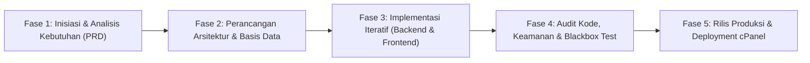

# LAPORAN PROYEK AKHIR DAN PAMERAN KARYA DIGITAL KREATIF

---

## IDENTITAS KARYA

* **Judul Karya:** SIM-BIM (Sistem Informasi Manajemen Terpadu & Portal Akademik SDI Bina Insan Mandiri)
* **Kategori Karya:** Aplikasi Web Terintegrasi / *Enterprise School Information System & Progressive Web App (PWA)*
* **Institusi Mitra:** Sekolah Dasar Islam (SDI) Bina Insan Mandiri Purwokerto, Kabupaten Banyumas, Jawa Tengah
* **Tahun Pengembangan:** 2026

---

## BAB I. DESKRIPSI KARYA

### 1.1. Latar Belakang / Masalah

Sekolah Dasar Islam (SDI) Bina Insan Mandiri Purwokerto merupakan lembaga pendidikan dasar swasta yang berkembang pesat dengan kurikulum integratif yang memadukan kurikulum nasional dan nilai-nilai kepesantrenan/keislaman (meliputi program Tahfidz Al-Qur'an, pembinaan karakter, dan pendampingan psikologis peserta didik). Seiring bertambahnya jumlah rombongan belajar (rombel), staf pengajar, dan peserta didik, pengelolaan administrasi sekolah menghadapi tantangan yang sangat kompleks.

Berdasarkan hasil asesmen dan analisis kebutuhan di lapangan, proses tata kelola sekolah sebelumnya masih mengandalkan pencatatan manual berbasis lembar kerja (*spreadsheet* Microsoft Excel) yang terpisah-pisah antarunit kerja. Pola kerja konvensional ini memicu serangkaian permasalahan struktural dan operasional:

1. **Fragmentasi Data dan Risiko Inkonsistensi (*Data Redundancy & Silos*):**  
   Data siswa, riwayat kepegawaian guru, pembagian rombel, hingga catatan keuangan tercatat dalam puluhan berkas Excel yang tersebar di komputer staf yang berbeda. Kondisi ini menyulitkan pembaruan data secara serempak (*real-time sync*), memicu duplikasi data ganda, dan menyulitkan pencarian arsip historis.
2. **Ketiadaan Rekam Jejak Terpusat untuk Perkembangan Karakter & Bimbingan Konseling (BK):**  
   Penanganan dinamika perilaku siswa selama ini hanya dicatat di buku catatan manual guru atau sekadar disampaikan lisan dalam ruang guru. Ketika perilaku tertentu memerlukan intervensi lanjutan oleh Guru BK, riwayat observasi awal dari guru kelas atau wali kelas sering kali hilang, terputus, atau bersifat subjektif tanpa kronologi longitudinal yang sahih.
3. **Presensi Manual Guru dan Siswa yang Rawan Manipulasi:**  
   Pencatatan presensi guru menggunakan lembar tanda tangan manual atau buku presensi rentan titip presensi, tidak memiliki verifikasi titik lokasi (*geofencing*), dan membutuhkan waktu berhari-hari pada akhir bulan bagi bagian tata usaha untuk merekap total jam mengajar serta bukti mengajar (*teaching evidence*).
4. **Keterbatasan Akses dan Transparansi bagi Wali Murid (*Information Gap*):**  
   Orang tua/wali murid hanya menerima informasi capaian belajar dan hafalan Al-Qur'an anak secara periodik saat pembagian rapor fisik di akhir semester. Tidak ada kanal digital resmi yang memungkinkan orang tua melihat perkembangan hafalan harian (*mutaba'ah yaumiyah*), presensi harian, agenda kalender akademik, dan surat edaran resmi secara mandiri dari gawai mereka.
5. **Kelemahan Keamanan dan Audit Data (*No Audit Trail*):**  
   Sistem berbasis berkas tidak memiliki mekanisme otorisasi hak akses bertingkat (*Role-Based Access Control*), pencatatan jejak log aktivitas (*audit log*), maupun sistem cadangan otomatis (*automated backup*). Kondisi ini menempatkan data rahasia siswa dan institusi pada risiko kehilangan (*data loss*) atau kebocoran akses.

---

### 1.2. Ide dan Tujuan Karya

#### 1.2.1. Ide Konseptual Karya
Menghadirkan **SIM-BIM**, sebuah ekosistem digital terpadu berbasis *web cloud architecture* yang berfungsi sebagai **Single Source of Truth** bagi seluruh aktivitas operasional, manajerial, bimbingan konseling, keagamaan, dan komunikasi SDI Bina Insan Mandiri. Sistem dirancang dengan antarmuka modern yang responsif (*mobile-friendly*) menggunakan pendekatan *Progressive Web App (PWA)*, sehingga dapat diakses secara instan oleh pimpinan, guru, dan orang tua melalui *browser* desktop maupun telepon pintar tanpa membebani memori penyimpanan perangkat.

#### 1.2.2. Tujuan Karya
1. **Digitalisasi Tata Kelola Terpadu:** Mengintegrasikan pengelolaan data induk (siswa, guru, rombel, tahun ajaran), presensi GPS, jurnal mengajar, buku nilai, dan manajemen sarana prasarana dalam satu basis data relasional yang aman.
2. **Kolaborasi Multidisiplin Guru BK & Wali Kelas:** Mewujudkan modul *Analisis & Monitoring Bimbingan Konseling (BK)* berstandar 8 prinsip etik bimbingan konseling anak dengan fitur tracking longitudinal dan ruang diskusi kolaborasi tertutup (*read-only tracking & commenting*) antara Guru BK dan Wali Kelas.
3. **Akuntabilitas Kehadiran & Kegiatan Belajar Mengajar:** Mengotomatiskan presensi kehadiran guru berbasis radius koordinat GPS sekolah disertai unggahan bukti foto mengajar real-time serta presensi kelas harian siswa.
4. **Transparansi Capaian Pendidikan Holistik ke Orang Tua:** Menyediakan *Portal Wali Murid* mandiri untuk memantau kehadiran anak, setoran hafalan Tahfidz (surah/ayat, nilai tajwid, kelancaran), buku nilai, tagihan keuangan, dan agenda sekolah secara transparan.
5. **Keamanan Informasi dan Kepatuhan Institusional:** Menerapkan sistem otorisasi multiperan yang ketat (*Role-Based Access Control*), enkripsi kredensial, proteksi formula injection, pencadangan basis data berkala, serta jejak rekam audit aktivitas sistem.

---

### 1.3. Target Pengguna

Karya SIM-BIM dirancang dengan memetakan kebutuhan spesifik dari 8 kelompok pengguna (*user personas*):

| No | Kelompok Pengguna | Peran & Aksesibilitas dalam Sistem |
| :---: | :--- | :--- |
| **1** | **Kepala Sekolah / Pimpinan** | Memantau dasbor eksekutif sekolah, tingkat kehadiran harian guru dan siswa, rekapitulasi capaian hafalan Al-Qur'an, laporan keuangan/aset, serta memvalidasi pengumuman institusi resmi. |
| **2** | **Staf Administrasi & Tata Usaha (Admin)** | Mengelola data master (siswa, GTK, kelas, mata pelajaran, penugasan guru), sistem kalender akademik, manajemen user, import/export data Excel massal, manajemen aset, dan pencadangan basis data. |
| **3** | **Guru Kelas / Guru Mata Pelajaran** | Melakukan absensi masuk/pulang berbasis GPS, mengunggah bukti mengajar, mengisi presensi harian siswa per jam pelajaran, menginput catatan observasi perilaku kelas, serta menyusun nilai buku nilai formatif/sumatif. |
| **4** | **Guru Bimbingan Konseling (BK)** | Mengelola lembar kasus pemantauan konseling anak secara longitudinal, menelaah laporan observasi perilaku rujukan guru, mencatat log tahapan intervensi, mengekspor rekap profesional BK, dan merespons diskusi kasus. |
| **5** | **Wali Kelas** | Mengawasi rekam kehadiran siswa di kelas binaannya, memantau rapor progres belajar, menerima notifikasi observasi/kasus BK anak didiknya, melihat rekam jejak bimbingan konseling secara *read-only*, serta memberikan komentar/tanggapan kolaboratif. |
| **6** | **Guru Tahfidz & Keagamaan** | Mencatat setoran hafalan juz/surah/ayat harian siswa, menilai mutu tajwid dan kelancaran (*mutaba'ah tahfidz*), serta mengelola rekap target kelulusan tahfidz peserta didik. |
| **7** | **Wali Murid / Orang Tua Siswa** | Mengakses portal khusus anak untuk memeriksa riwayat presensi, perkembangan hafalan Al-Qur'an harian, catatan perkembangan sikap, surat pengumuman sekolah, serta jadwal kegiatan akademik. |
| **8** | **Calon Wali Murid / Publik** | Mengakses informasi profil sekolah, program unggulan, artikel kegiatan, kalender akademik publik, dan formulir pendaftaran peserta didik baru (SPMB / PPDB Online). |

---

### 1.4. Keunggulan Karya

Dibandingkan dengan sistem informasi sekolah konvensional pada umumnya, SIM-BIM memiliki keunggulan kompetitif dan diferensiasi fitur sebagai berikut:

```
┌──────────────────────────────────────────────────────────────────────────────┐
│                            KEUNGGULAN UTAMA SIM-BIM                          │
├──────────────────────────────┬──────────────────────────────┬────────────────┤
│    KOLABORASI BK & WALI      │    PRESENSI GEOLOKASI GPS    │  TAHFIDZ CORE  │
│ Tracking Longitudinal Kasus  │ Radius Validasi Koordinat    │ Penilaian Juz, │
│ + Diskusi Tertutup Dua Arah  │ + Bukti Foto Mengajar        │ Surah & Tajwid │
├──────────────────────────────┼──────────────────────────────┼────────────────┤
│       PORTAL WALI REAL-TIME  │     FAIL-SAFE ARCHITECTURE   │ AUDIT LOG 100% │
│ Cek Mutaba'ah, Absen & Nilai │ Proteksi Error Skema DB &    │ Jejak Digital  │
│ Langsung dari Gawai Mandiri  │ Sanitasi Formula Injeksi     │ Setiap Aksi    │
└──────────────────────────────┴──────────────────────────────┴────────────────┘
```

1. **Sistem Kolaborasi Terpadu Bimbingan Konseling (BK) & Wali Kelas:**  
   Menyediakan alur penanganan siswa komprehensif mulai dari catatan observasi perilaku harian di kelas hingga eskalasi ke ruang BK. Wali Kelas secara otomatis menerima notifikasi (email & in-app) saat anak binaannya tercatat di BK, dapat memantau linimasa intervensi secara aman (*read-only*), serta dapat memberikan tanggapan/masukan langsung melalui fitur ruang diskusi kasus.
2. **Presensi Berbasis Koordinat Geofencing GPS & Bukti Foto:**  
   Mencegah kecurangan presensi dengan memvalidasi jarak koordinat perangkat guru terhadap titik sentral sekolah secara presisi, disertai kewajiban melampirkan dokumentasi foto kegiatan mengajar di kelas.
3. **Modul Spesifik Sekolah Islam (Tahfidz & Karakter Adab):**  
   Memiliki struktur basis data khusus untuk merekam setoran hafalan Al-Qur'an (nama surah, rentang ayat, status kelancaran, adab membaca) yang terhubung langsung ke laporan perkembangan di gawai orang tua.
4. **Papan Pengumuman Cerdas Berbasis Target Pembaca:**  
   Fitur pengumuman resmi yang dapat diarahkan tepat sasaran (khusus Guru, khusus Wali Murid, atau Umum) dilengkapi pelacakan status baca (*read/unread tracking*), mencegah surat edaran tertukar atau terlewat.
5. **Arsitektur Tangguh & Keamanan Tinggi (*Fail-Safe & Secure*):**  
   Dilengkapi isolasi query relasional yang toleran terhadap kegagalan migrasi (*graceful fallback*), proteksi injeksi formula pada file ekspor Excel, mitigasi brute-force login, dan audit logging pada setiap manipulasi data master.

---

## BAB II. PROSES PENGEMBANGAN

### 2.1. Tahapan Pembuatan Karya

Pengembangan SIM-BIM dilaksanakan menggunakan metodologi **Agile Software Development Lifecycle (Agile SDLC)** yang dikolaborasikan dengan paradigma **Agentic AI-Driven Development** dalam 5 fase utama:



#### 1. Fase Inisiasi & Analisis Kebutuhan (*Discovery & PRD*)
* Melakukan studi lapangan dan wawancara mendalam bersama Kepala Sekolah, staf tata usaha, guru kelas, dan koordinator BK SDI Bina Insan Mandiri.
* Mengumpulkan artefak berkas Excel lama dan mengidentifikasi entitas, relasi, serta alur kerja administrasi manual.
* Merumuskan dokumen formal *Product Requirement Document (PRD)* yang mendefinisikan 80+ *Functional Requirements (FR)* dan spesifikasi nonfungsional.

#### 2. Fase Perancangan Arsitektur (*Architectural Design*)
* **Perancangan Basis Data:** Merancang Entity Relationship Diagram (ERD) berbasis MySQL yang mencakup lebih dari 28 tabel relasional yang dinormalisasi (menghubungkan pengguna, siswa, wali, guru, rombel, presensi, jurnal, nilai, tahfidz, aset, hingga kasus konseling BK).
* **Perancangan RESTful API:** Mendefinisikan kontrak endpoint API berstandar JSON API dengan mekanisme autentikasi token *Laravel Sanctum*.
* **Perancangan Desain Antarmuka (UI/UX System):** Mengadopsi prinsip desain ramah anak dan institusi Islam modern (*clean, warm, emerald-based palette, rounded aesthetic*).

#### 3. Fase Implementasi Iteratif (*Sprints Implementation*)
* **Sprint 1 (Fondasi & Master Data):** Autentikasi multiperan, manajemen GTK, siswa, rombel, dan modul import/export Excel.
* **Sprint 2 (Presensi & Pembelajaran):** Presensi geolokasi GPS guru, presensi harian kelas, bukti foto mengajar, dan buku nilai digital.
* **Sprint 3 (Kekhasan Sekolah & Portal):** Modul tahfidz mutaba'ah Al-Qur'an, portal wali murid, pengumuman bertarget, dan kalender akademik terpadu.
* **Sprint 4 (Sistem BK & Kolaborasi Wali Kelas):** Observasi perilaku kelas, eskalasi otomatis ke Guru BK, rekam jejak longitudinal BK, dan forum diskusi komentar kasus terproteksi.

#### 4. Fase Pengujian Kualitas & Audit (*Quality Assurance & Testing*)
* **Blackbox Functional Testing:** Menguji seluruh skenario tombol, navigasi, validasi form, dan respons antarmuka pada berbagai peran pengguna.
* **Security & Vulnerability Audit:** Uji batas hak akses (RBAC), sanitasi formula ekspor file Excel, dan proteksi cross-class data access.
* **Bug Remediation:** Menyelesaikan kendala pergeseran tanggal akibat zona waktu (*UTC timezone shift*) pada catatan tanggal BK dan penguatan skema basis data komentar.

#### 5. Fase Distribusi Produksi (*Deployment & Staging*)
* Penyiapan basis data MySQL di lingkungan server cPanel hosting (`sdislambims.my.id`).
* Kompilasi aset produksi frontend menggunakan Vite bundler berkinerja tinggi.
* Konfigurasi berkas lingkungan `.env`, izin penyimpanan (*storage symlink*), dan optimasi cache aplikasi.

---

### 2.2. Teknologi / Tools yang Digunakan

| Kategori | Teknologi / Perangkat Lunak | Alasan Pemilihan & Peran |
| :--- | :--- | :--- |
| **Backend Framework** | **Laravel 11.x (PHP 8.2+)** | Framework PHP modern berstandar enterprise dengan keamanan tinggi, ORM Eloquent yang ekspresif, manajemen migrasi skema tabel, dan ekosistem API Sanctum. |
| **Frontend Framework** | **Vue 3 (Composition API & `<script setup>`)** | Framework JavaScript reaktif berkinerja tinggi yang memungkinkan modularitas komponen antarmuka yang bersih dan mudah dirawat. |
| **Bahasa Pemrograman** | **TypeScript & PHP** | Memberikan keamanan tipe data (*type safety*) pada frontend untuk meminimalkan *runtime error* pada form dan manipulasi state. |
| **Styling & CSS Engine** | **Tailwind CSS v4** | *Utility-first CSS framework* modern yang memungkinkan styling UI responsif, elegan, dan ringan tanpa dependensi CSS eksternal berlebih. |
| **State Management** | **Pinia** | Store manajemen state terpusat untuk menyimpan status autentikasi pengguna, hak akses role, preferensi tema, dan token sesi. |
| **Basis Data** | **MySQL 8.x / MariaDB** | Database relasional berkecepatan tinggi dengan integritas referensial kunci asing (*foreign key constraints*), indexing optimal, dan dukungan transaksi ACID. |
| **Build & Tooling** | **Vite 8.x** | *Frontend tooling engine* generasi baru dengan *Hot Module Replacement (HMR)* super cepat dan hasil bundel aset produksi yang sangat teroptimasi. |
| **Pustaka Pendukung** | **PhpSpreadsheet & SweetAlert2** | Menangani ekspor-impor berkas Microsoft Excel (.xlsx) serta dialog interaksi konfirmasi pengguna yang informatif dan ramah visual. |
| **Server & Hosting** | **Laragon (Dev) & cPanel Hosting (Prod)** | Lingkungan server lokal berbasis Apache/MySQL untuk percepatan pengkodean dan server cPanel berbasis cloud untuk operasional daring sekolah. |
| **Version Control** | **Git & GitHub** | Manajemen riwayat revisi kode sumber, pelacakan branch, dan otomatisasi sinkronisasi kode tim pengembang. |

---

### 2.3. Pemanfaatan AI / Vibe Coding / Role Prompting

Proyek SIM-BIM menerapkan paradigma pengembangan modern berbasis kecerdasan buatan (*AI-Assisted Pair Programming* dan *Agentic Vibe Coding*) secara intensif dari tahap konseptualisasi hingga penyelesaian kode produksi.

```
┌─────────────────────────────────────────────────────────────────────────────┐
│                 PEMANFAATAN AI DALAM ARSITEKTUR SIM-BIM                     │
├──────────────────────────────┬──────────────────────────────────────────────┤
│ METODE PENERAPAN AI          │ IMPLEMENTASI NYATA PADA SIM-BIM              │
├──────────────────────────────┼──────────────────────────────────────────────┤
│ 1. Role-Based Prompting      │ Penetapan persona AI sebagai Principal       │
│                              │ Software Architect, Database Specialist,     │
│                              │ dan Senior Cyber-Security Auditor.           │
│ 2. Vibe Coding Iteratif      │ Translasi narasi instruksi bisnis pengguna   │
│                              │ langsung menjadi arsitektur kode reaktif     │
│                              │ (Vue 3 + Tailwind CSS + Laravel API).        │
│ 3. Automated Code Auditing   │ Analisis mendalam celah keamanan, race       │
│                              │ condition, dan formula injection pada Excel. │
│ 4. Complex Bug Troubleshooting│ Investigasi akar masalah pergeseran tanggal  │
│                              │ UTC dan isolasi fail-safe query database.    │
└──────────────────────────────┴──────────────────────────────────────────────┘
```

#### 2.3.1. Penerapan Role-Based Prompting
Dalam setiap fase rekayasa, asisten AI diposisikan menggunakan peran (*role prompting*) terspesialisasi:
* **Sebagai System Architect:** Merancang normalisasi skema 28 tabel database untuk mendukung pelaporan siswa longitudinal tanpa redundansi data.
* **Sebagai Defensive Security Engineer:** Menginspeksi titik kerentanan pada input pengguna, sanitasi nilai formula Excel (`=`, `+`, `-`, `@`), dan pembatasan otorisasi Guru BK vs Wali Kelas.
* **Sebagai Frontend Specialist:** Mengonstruksi hierarki komponen Vue 3 yang ramah pengguna dengan transisi animasi halus (*Tailwind motion*).

#### 2.3.2. Praktik Vibe Coding dalam Pemecahan Masalah Nyata
Konsep *Vibe Coding* diterapkan untuk mengeksekusi kebutuhan institusi yang kompleks secara cepat melalui deskripsi deklaratif berstandar tinggi:
1. **Pembuatan Otomatis Modul Kolaborasi Komentar BK:**  
   Ketika sekolah membutuhkan mekanisme kolaborasi agar Wali Kelas dapat memantau siswa binaannya yang masuk catatan BK tanpa mengubah catatan psikologis dari Guru BK, AI secara mandiri merumuskan migrasi basis data `bk_case_comments`, model relasi Eloquent, endpoint API controller, sistem notifikasi otomatis email & in-app, serta antarmuka tab diskusi di sisi frontend dalam satu siklus iterasi yang kohesif.
2. **Penyelesaian Masalah Tanggal Mundur (*Timezone UTC Bug Remediation*):**  
   Pengguna melaporkan anomali di mana tanggal pencatatan sesi BK (misal tanggal 9) bergeser menjadi tanggal 8 setelah beberapa menit. Melalui penelusuran AI, akar masalah ditemukan pada serialisasi objek `Date()` JavaScript yang dikonversi ke ISO 8601 UTC oleh Axios sebelum disimpan ke basis data. AI merekayasa ulang modul `date.ts` dan menambahkan model casting `'date:Y-m-d'` pada Laravel, sehingga nilai tanggal terkunci pada waktu lokal Indonesia (WIB) tanpa distorsi jam UTC.
3. **Penerapan Arsitektur Fail-Safe Anti-Crash:**  
   Ketika terjadi galat saat penarikan detail data di server produksi cPanel akibat perbedaan status migrasi tabel, AI merancang pola pengamanan terisolasi (*graceful degradation*) menggunakan `try-catch block` dan `Schema::hasTable` check. Hasilnya, jika ada tabel opsional yang belum dimigrasi di server produksi, modul utama tetap dapat menyajikan data rekam jejak siswa dengan mulus tanpa memunculkan pesan error 500.

---

### 2.4. Hasil Pengembangan

Pengembangan proyek SIM-BIM telah menghasilkan sistem informasi sekolah komprehensif yang siap beroperasi secara penuh (*production-ready*) dengan capaian modul fungsional sebagai berikut:

#### 2.4.1. Ringkasan 21 Modul yang Berhasil Dibangun & Terintegrasi

| No | Nama Modul | Cakupan Fitur & Kemampuan Utama |
| :---: | :--- | :--- |
| **1** | **Autentikasi & Akun** | Login multifaktor aman, pembatasan upaya gagal (brute-force lock), ganti password wajib, reset kredensial, dan manajemen token Sanctum. |
| **2** | **Otorisasi Multiperan (RBAC)** | Pembagian wewenang ketat untuk 5 kelompok peran: Admin/Pimpinan, Guru Mapel, Guru BK, Wali Kelas, dan Wali Murid. |
| **3** | **Data Induk Siswa** | Manajemen biodata lengkap peserta didik, nomor induk (NIS/NISN), kontak orang tua, filter kelas aktif, dan riwayat mutasi/kelulusan. |
| **4** | **Data Pendidik & Tenaga Kependidikan** | Basis data profil guru, riwayat pendidikan, status kepegawaian (GTY/GTT), jabatan fungsional, dan penugasan mengajar. |
| **5** | **Rombel & Kelas** | Manajemen struktur tingkat kelas 1 s/d 6, penetapan wali kelas, kapasitas ruang, dan alokasi peserta didik. |
| **6** | **Jadwal & Mata Pelajaran** | Pengaturan kalender jam pelajaran, pemetaan mapel kurikulum nasional dan keislaman, serta matriks jadwal mengajar mingguan. |
| **7** | **Presensi GPS & Selfie Guru** | Absensi mandiri berbasis validasi radius koordinat geofencing sekolah, deteksi jarak real-time, dan pencatatan jam kerja. |
| **8** | **Jurnal & Bukti Mengajar** | Dokumentasi materi ajar harian per sesi kelas disertai kewajiban unggah foto kegiatan pembelajaran langsung. |
| **9** | **Presensi Harian Siswa** | Presensi kelas per mata pelajaran (Hadir, Sakit, Izin, Alpa) dengan rekapitulasi kehadiran otomatis per bulan. |
| **10** | **Buku Nilai Digital** | Penilaian formatif, sumatif, capaian tujuan pembelajaran (TP), dan kalkulasi otomatis nilai akhir mata pelajaran. |
| **11** | **Tahfidz & Mutaba'ah Al-Qur'an** | Input setoran hafalan surah/ayat, penilaian makharijul huruf, tajwid, adab mengaji, serta progres target juz Al-Qur'an. |
| **12** | **Observasi Perilaku Kelas** | Pencatatan anekdot perkembangan adab/perilaku siswa di kelas oleh guru pengajar dengan fitur eskalasi otomatis ke ruang BK. |
| **13** | **Monitoring Bimbingan Konseling (BK)** | Dasbor analisis psikologis anak, pemantauan 10 fokus kasus, agenda review longitudinal, dan buku pedoman 8 prinsip etik BK. |
| **14** | **Forum Diskusi Kasus BK - Wali Kelas** | Ruang tanggapan tertutup antara Guru BK dan Wali Kelas dengan sistem notifikasi timbal balik (in-app dan email). |
| **15** | **Papan Pengumuman Pintar** | Publikasi edaran resmi dengan filter sasaran pembaca terarah dan indikator pelacakan pembaca (*read/unread*). |
| **16** | **Kalender Akademik Terpadu** | Penjadwalan agenda akademik, libur nasional, ujian, dan kegiatan kepesantrenan dengan hak akses baca seluruh pengguna dan hak edit khusus Admin. |
| **17** | **Portal Mandiri Wali Murid** | Akses orang tua untuk melihat kehadiran anak, perkembangan hafalan tahfidz, nilai belajar, dan catatan guru dari smartphone. |
| **18** | **E-Rapor & Cetak PDF** | Generator rapor capaian belajar komprehensif berformat PDF yang siap dicetak pada akhir semester. |
| **19** | **Manajemen Keuangan / SPP** | Pencatatan status pembayaran iuran syahriah/SPP, riwayat transaksi, dan rekapitulasi tunggakan siswa. |
| **20** | **SPMB / PPDB Online** | Formulir penerimaan murid baru berbasis web publik, upload berkas persyaratan, dan seleksi calon peserta didik. |
| **21** | **Sarpras, Backup & Audit Log** | Pendataan inventaris aset sekolah, unduh cadangan basis data (.sql), dan rekam jejak riwayat aktivitas (*audit trail*). |

---

#### 2.4.2. Dokumentasi Tampilan Antarmuka Aplikasi

```
┌─────────────────────────────────────────────────────────────────────────────┐
│                   ARSITEKTUR ANTARMUKA DASBOR SIM-BIM                       │
├─────────────────────────────────────────────────────────────────────────────┤
│ [TA 2026/2027 • Gasal] SDI Bina Insan Mandiri Purwokerto        (Profil/Akun)│
├─────────────────┬───────────────────────────────────────────────────────────┤
│ MENU UTAMA:     │  DASBOR ANALISIS & MONITORING BK                          │
│ • Profil Saya   │  ├── Ringkasan: [Total Kasus] [Dalam Pemantauan] [Selesai]│
│ • Pengumuman    │  ├── Agenda Review Terdekat: [Daftar Siswa Evaluasi]      │
│                 │  └── Distribusi: [Per Kelas] & [10 Kategori Fokus Kasus]  │
│ DATA & AKADEMIK:├───────────────────────────────────────────────────────────┤
│ • Data Siswa    │  TABEL KASUS LONGITUDINAL:                                │
│ • Data Guru     │  [No] [Nama Siswa] [Kelas] [Fokus] [Status] [Aksi / Tab]  │
│ • Kelas/Jadwal  │  ─────────────────────────────────────────────────────────┤
│                 │  TAB SISWA & DETAIL SESI INTERVENSI (READ-ONLY WALI KELAS)│
│ PROGRES SISWA:  │  ├── Riwayat Sesi Intervensi & Catatan Telaah Guru BK     │
│ • Presensi GPS  │  └── RUANG DISKUSI & KOMENTAR KOLABORASI:                 │
│ • Jurnal Bukti  │      • [Wali Kelas]: "Anak sudah mulai aktif bertanya"    │
│ • Buku Nilai    │      • [Guru BK]: "Terima kasih ustadzah, terus pantau"   │
│ • Tahfidz       │      • [Form Input Tanggapan Baru & Kirim Notifikasi]     │
│ • Monitoring BK │                                                           │
└─────────────────┴───────────────────────────────────────────────────────────┘
```

#### 2.4.3. Dampak Nyata Penerapan Karya bagi Sekolah
1. **Efisiensi Waktu Rekapitulasi hingga 90%:** Rekap presensi guru dan siswa yang sebelumnya membutuhkan waktu 3–5 hari kerja kini tersaji otomatis dalam hitungan detik via ekspor Excel/PDF.
2. **Kerahasiaan dan Keteraturan Penanganan Masalah Siswa:** Seluruh catatan bimbingan konseling terdokumentasi secara rapi, memiliki kronologi bertahap (*evidence-based*), serta terhindar dari kebocoran informasi karena hanya dapat dibaca oleh Guru BK dan Wali Kelas bersangkutan.
3. **Peningkatan Keterikatan Orang Tua Murid:** Orang tua merasa lebih tenang dan terlibat aktif karena dapat memantau capaian hafalan Al-Qur'an dan kedisiplinan anak setiap hari tanpa harus menunggu pertemuan tatap muka akhir semester.
4. **Keberlanjutan Data Digital Institusi:** Sekolah memiliki pangkalan data digital tunggal yang terlindungi, memudahkan akreditasi sekolah, pelaporan dinas pendidikan, serta regenerasi data pada tahun-tahun ajaran mendatang.

---

## BAB III. PENUTUP & KESIMPULAN

Pengembangan **SIM-BIM (Sistem Informasi Manajemen Terpadu SDI Bina Insan Mandiri Purwokerto)** telah berhasil membuktikan bahwa pemanfaatan teknologi web modern yang dipadukan dengan paradigma kecerdasan buatan (*AI-Assisted Vibe Coding*) mampu menghasilkan karya perangkat lunak skala enterprise yang tepat guna, cepat, aman, dan berdaya guna tinggi. 

Sistem ini tidak hanya menyelesaikan permasalahan klasik administrasi manual berbasis spreadsheet, melainkan juga mengangkat martabat tata kelola sekolah Islam terpadu ke era digital melalui integrasi holistik antara capaian akademik, rekam hafalan Tahfidz Al-Qur'an, serta pendampingan karakter anak yang profesional dan kolaboratif.

---
*Laporan ini disusun secara resmi untuk memenuhi persyaratan Penilaian Proyek Akhir dan Pameran Karya Digital Kreatif Tahun 2026.*

